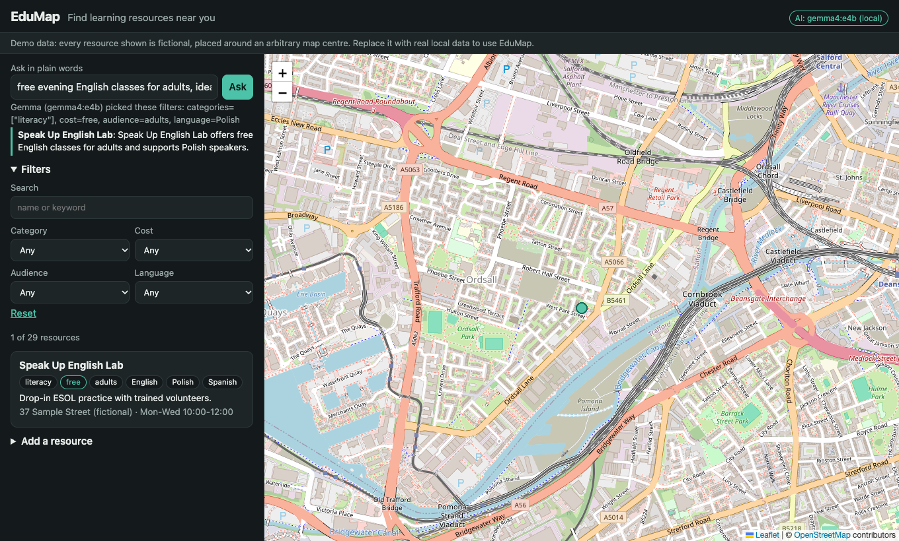

# EduMap

An open-source map of local education resources: schools, libraries, tutoring, skills courses, adult literacy, STEM clubs, early years, special-needs support, study spaces, free computer access and scholarships. Filter by category, cost, audience and language, or just ask in plain words and a local open-weight **Gemma** model finds matches.



EduMap started as an [AppSheet](https://www.appsheet.com/) prototype built at the ATAI Fest hackathon (May 2025). That prototype sits behind a Google sign-in and the original repo held only a link to it, so this version is a fresh, self-hostable rebuild of the same idea (a map of education resources), not a port of the AppSheet screens.

> **The demo data is fictional.** Every resource in the seed set is invented and placed around an arbitrary map centre so the app has something to show. Replace it with real local listings before using EduMap for anything real.

## Run it

Needs Node 22.5+ (it uses the built-in `node:sqlite`, so there is no database to install).

```bash
npm install && npm start
```

Then open http://localhost:3000 (set `PORT` to change it). The first start seeds a local SQLite file at `data/edumap.db`.

### Optional: the Gemma assistant

The "Ask in plain words" box uses [Gemma](https://ai.google.dev/gemma) through [Ollama](https://ollama.com), entirely on your machine. No cloud keys, nothing leaves your computer.

```bash
ollama pull gemma4:e4b
```

If Ollama is not running, the app still works: search and filters are unaffected and questions fall back to simple keyword matching. The header badge shows which mode you are in.

## How the AI part works

Gemma is never trusted to invent places.

1. **Question → filters.** Gemma turns the question into structured filters (categories, cost, audience, language, keywords) using a JSON schema. Values outside the allowed lists are discarded.
2. **Filters → results, in code.** The filters run against the database. If they match nothing, the fuzziest ones (keywords, language, audience) are relaxed step by step.
3. **Matches → explanation.** Gemma sees only the top matches and picks up to three with a one-line reason. Any id it returns that is not in the matched set is dropped.

The code is in [`server/ai.ts`](server/ai.ts). Model, URL and timeout are configurable.

| Variable | Default | Purpose |
| --- | --- | --- |
| `PORT` | `3000` | HTTP port |
| `EDUMAP_DB` | `data/edumap.db` | SQLite file path |
| `OLLAMA_URL` | `http://127.0.0.1:11434` | Ollama endpoint |
| `EDUMAP_MODEL` | `gemma4:e4b` | Any Ollama model that supports structured outputs |
| `EDUMAP_AI_TIMEOUT_MS` | `90000` | Per-request model timeout |
| `EDUMAP_READONLY` | unset | Set to `1` to disable adding resources (use for public demos) |

## Features

- Interactive map (Leaflet + OpenStreetMap tiles) synced with a result list
- Filters for category, cost, audience, language and free text
- Natural-language search with a local model, with a no-AI fallback
- Add a resource by clicking the map (no accounts; disable with `EDUMAP_READONLY=1`)
- JSON API: `GET /api/resources`, `POST /api/resources`, `POST /api/ask`, `GET /api/meta`

## Develop

```bash
npm test            # vitest: filtering, validation, API, grounded-AI behaviour (model mocked)
npm run typecheck
npm run dev         # API with auto-reload on :3000
npm run dev:client  # Vite dev server on :5173, proxies /api to :3000
```

Stack: TypeScript, Hono, `node:sqlite`, Vite, Leaflet. Small enough to read in one sitting.

Map tiles are loaded from OpenStreetMap, so the map needs an internet connection; the rest works offline.

## Deploy a free demo

A `Dockerfile` and [`render.yaml`](render.yaml) are included. The hosted demo runs read-only and without the AI assistant (no GPU, no Ollama), so questions use the keyword fallback; run it locally to get Gemma.

## Adding your own data

Seed data lives in [`server/seed.ts`](server/seed.ts). Delete `data/edumap.db` after editing it to reseed, or POST new resources to `/api/resources`.

## License

MIT
